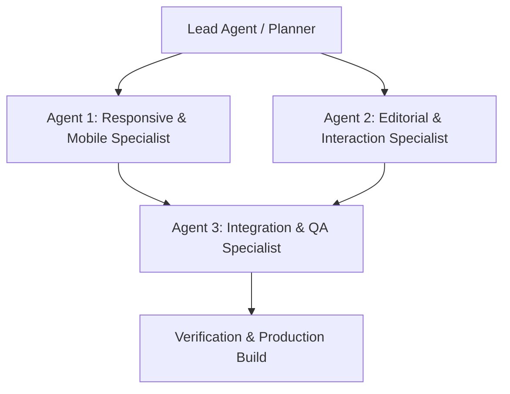

# Design Specification: Portfolio Design Refinement & Mobile Fixes

**Date:** 2026-10-05  
**Project:** Trisha Carias Portfolio (`star`)  
**Status:** Approved  

## 1. Overview & Objectives
The goal of this project is to perform a comprehensive refinement of the portfolio design and resolve mobile responsiveness flaws. The project executes using a multi-agent orchestration workflow divided across specialist roles:
1. **Agent 1:** Responsive Architecture & Mobile Specialist (navigation drawer, scroll locks, viewport clamping, overflow prevention, responsive grid adaptation).
2. **Agent 2:** Editorial Design & Micro-Interaction Specialist (typography hierarchy, card interaction, simulated data visualizations, accessibility & contrast, touch/hover micro-animations).
3. **Agent 3:** Cross-Device Integration & QA Auditor (TypeScript compilation, Vite build verification, cross-breakpoint visual and ergonomic auditing).

---

## 2. Multi-Agent Architecture & Responsibility Matrix

### File Boundaries
- **Agent 1:**
  - `src/components/Header.tsx`
  - `src/index.css`
  - Responsive layout containers and media queries in `src/sections/Hero.tsx`, `src/sections/Experience.tsx`, `src/sections/Paths.tsx`, and `src/sections/Contact.tsx`.
- **Agent 2:**
  - `src/sections/Projects.tsx`
  - Visual styling, badges, micro-interactions, button hover/focus states in `src/sections/Hero.tsx`, `src/sections/About.tsx`, and `src/sections/Contact.tsx`.
- **Agent 3:**
  - Verification test suite: `tsc`, `npm run build`, responsive checks across 320px, 375px, 768px, 1024px+.

---

## 3. Detailed Specifications

### 3.1 Mobile Navigation & Header (`src/components/Header.tsx`)
- **Backdrop Overlay:** Add a semi-transparent backdrop blur (`bg-black/30 backdrop-blur-sm fixed inset-0 z-40`) when the drawer is open.
- **Scroll Lock:** Automatically set `document.body.style.overflow = "hidden"` when the drawer opens, restoring it upon close or unmount.
- **Keyboard & Click Away:** Close menu on pressing `Escape` or clicking outside the drawer.
- **Touch Targets:** Minimum touch height of 48px for all mobile drawer links and buttons.
- **Active State Highlighting:** Ensure current active section reflects cleanly in both desktop pill and mobile menu.

### 3.2 Viewport Tuning & Hero Mobile Layout (`src/sections/Hero.tsx`)
- **Fluid Typography Clamping:**
  - Revise headline to `text-[clamp(2.4rem,6.8vw,6.8rem)]` with leading `leading-[1.0] sm:leading-[0.92]`. Prevents large text overflow or single-word breaks on 320px–390px screens.
- **Overflow Protection:**
  - Wrap decorative background circle elements in an `overflow-hidden` container so negative margins cannot trigger horizontal scrolling.
- **Portrait Card Tuning:**
  - Adjust padding and the floating "Based in Cavite, Philippines" badge layout so it stays proportionate on compact mobile displays.

### 3.3 Layout Flow & Rhythm Across Sections
- **Consistent Section Spacing:**
  - Adjust section padding across all sections to `py-14 sm:py-20 lg:py-28`.
- **Experience Workflow Steps (`src/sections/Experience.tsx`):**
  - Add a vertical timeline indicator on mobile screens between steps `01` to `04` while keeping horizontal arrows for `sm:` and up.
- **Career Paths Cards (`src/sections/Paths.tsx`):**
  - Style mobile cards as cleanly separated rounded cards (`rounded-2xl border border-[#17201d]/15 bg-[#f4f0e8] p-6 mb-3`) transitioning into the continuous 3-column grid on desktop (`md:grid-cols-3`).
- **Contact Section (`src/sections/Contact.tsx`):**
  - Ensure decorative circles remain pointer-events-none and clipped. Buttons stack gracefully on mobile screens (<480px) and align horizontally on larger screens.

### 3.4 Projects Showcase & Interactive Polish (`src/sections/Projects.tsx`)
- **Data File Analyzer:**
  - Interactive histogram with tooltips or hover animations representing sample metrics.
  - Tag pills: `Python`, `Pandas`, `Matplotlib`, `CSV Automation`.
- **Workflow Improvement:**
  - Polished interactive process stages with hover elevation and sequential numbering indicators.
  - Tag pills: `Process Mapping`, `Operations`, `Friction Audit`.

### 3.5 Accessibility & UI Refinement
- Ensure text contrast meets WCAG AA standards.
- Add accessible `focus-visible` styling (`focus-visible:outline-none focus-visible:ring-2 focus-visible:ring-[#d24a2c] focus-visible:ring-offset-2`).
- Smooth micro-motion on buttons (`active:scale-[0.98]`).

---

## 4. Verification & Success Criteria
1. `npm run build` succeeds without TypeScript or Vite bundle errors.
2. Zero horizontal scrolling at screen widths 320px, 360px, 375px, 390px, 414px, 768px, and 1280px.
3. Mobile drawer opens smoothly, locks background scrolling, responds to `Escape`, closes on link selection, and provides easy-to-tap targets.
4. Rich interactive feel with polished hover states and crisp typography on both mobile and desktop devices.
